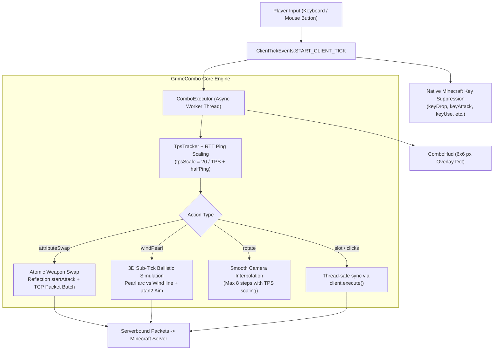

# GrimeCombo ⚡

[](https://fabricmc.net/)
[](https://openjdk.org/)
[](#-architecture--killer-features)
[](LICENSE)
[](https://github.com/ValetJk010/GrimeCombo)

> **Language / Язык:** **English** | [Русский](README_RU.md)

A next-generation client-side macro combo and physics simulation engine for **Minecraft Fabric (1.21.x / 26.2, Java 25)**, introducing **MOBA-style tactical ability chaining** to competitive Minecraft PvP and PvE.

---

## 📑 Table of Contents

- [🎯 Motivation & The Problem](#-motivation--the-problem)
- [⚡ Architecture & Killer Features](#-architecture--killer-features)
  - [1. Atomic Attribute Swap (Spear Dash / Weapon Swap)](#1-atomic-attribute-swap-spear-dash--weapon-swap)
  - [2. Wind Pearl: 3D Sub-Tick Ballistic Intercept Physics](#2-wind-pearl-3d-sub-tick-ballistic-intercept-physics)
  - [3. Dynamic TPS & RTT Ping Scaling (TpsTracker)](#3-dynamic-tps--rtt-ping-scaling-tpstracker)
  - [4. Native Key Suppression (START_CLIENT_TICK Pipeline)](#4-native-key-suppression-start_client_tick-pipeline)
  - [5. Declarative TOML Configuration & Hot Reload](#5-declarative-toml-configuration--hot-reload)
  - [6. Minimalist HUD State Indicator](#6-minimalist-hud-state-indicator)
- [🛠️ Action Reference](#️-action-reference)
- [⚙️ Configuration Examples (`grimecombo.toml`)](#️-configuration-examples-grimecombotoml)
- [🛡️ Anti-Cheat Analysis & Server Considerations](#️-anti-cheat-analysis--server-considerations)
- [📦 Build & Installation](#-build--installation)
- [📄 License](#-license)

---

## 🎯 Motivation & The Problem

Modern competitive Minecraft (starting from 1.21+ updates featuring *Wind Charges*, the *Mace*, custom spear thrusts (*Spear Dash*), and *Crystal PvP*) has shifted towards hyper-fast, mechanical ability combat. High-level engagements demand split-second precision:
- A player must cycle hotbar items, aim at strict fractional angles, activate abilities, reset cooldowns, switch weapons, and restore slots within **50–100 milliseconds**.
- **The Human Bottleneck:** Average human reaction time is 200–250 ms. Physical finger jitter and misclicks frequently cause fatal errors (failed pearl trickshots, weapon drops, or missed crystal hits).
- **Server Lag & Variable TPS:** On overloaded multiplayer servers, tick rates fluctuate from 20 down to 10–14 TPS. Hardcoded macro delays fail because the server drops packets or receives them out of phase.
- **Vanilla Input Engine Limitations:** Minecraft's native `handleKeybinds()` intercepts key events sequentially on the render thread, inducing micro-delays and input conflicts.

**GrimeCombo resolves these challenges at an architectural level:**
1. Unifies complex multi-step mechanics into **deterministic tactical abilities** bound to a single keyboard key or mouse button.
2. Dispatches all macro execution onto an asynchronous worker pool (`CompletableFuture`), guaranteeing zero render frame drops and unaffected client FPS.
3. Computes real-time 3D ballistic intercept trajectories factoring in player momentum, gravity, air resistance, and network RTT ping.
4. Executes atomic weapon attribute swapping within a 0 ms TCP packet batching frame.

---

## ⚡ Architecture & Killer Features



### 1. Atomic Attribute Swap (Spear Dash / Weapon Swap)

The **Attribute Swap** mechanic leverages the activation impulse or special behavior of one item (such as a spear dash, lance charge, or trident impulse) while instantly delivering the attack attributes of another weapon (an axe with maximum base damage or a knockback sword):

* **0 ms TCP Packet Batching:**
  Within a single client synchronization frame (`client.execute()`), GrimeCombo sends a slot switch packet for the activation weapon (`ServerboundSetCarriedItemPacket(useSlot)`), triggers the attack, and **instantly** switches to the target weapon (`ServerboundSetCarriedItemPacket(targetSlot)`). The operating system batches these packets into a single TCP frame, registering the attack on the server without delaying the client's visual render pipeline.
* **Java Reflection Dispatch (`startAttack`):**
  Instead of simulating a held attack key across multiple ticks, GrimeCombo directly accesses Minecraft's private `startAttack()` method via Java Reflection, with seamless fallback to `gameMode.attack()` and `ServerboundSwingPacket`.
* **Result:** Full momentum retention coupled with instantaneous high-tier weapon damage on target impact.

---

### 2. Wind Pearl: 3D Sub-Tick Ballistic Intercept Physics

The **Wind Pearl** trickshot is one of the most mechanically demanding techniques in modern PvP: a player throws an *Ender Pearl* and detonates it in mid-air using a *Wind Charge*, accelerating the pearl to achieve instant 40–80+ block escapes and engages.

Executing this manually is inconsistent due to contrasting physics models: the pearl travels on a parabolic trajectory affected by gravity and air drag, while the wind charge travels linearly at a constant speed of $1.5$ blocks/tick.

GrimeCombo computes a **real-time 3D ballistic trajectory simulation**:

1. **Player Momentum Compensation:**
   $$\vec{v}_{pearl} = \vec{v}_{look} \cdot 1.5 + \vec{v}_{player}$$
   The engine captures player velocity (`player.getDeltaMovement()`) and ground contact status (`onGround`).
2. **60-Tick Forward Pearl Trajectory Integration:**
   $$v_y(t+1) = (v_y(t) - 0.03) \times 0.99$$
   $$v_x(t+1) = v_x(t) \times 0.99, \quad v_z(t+1) = v_z(t) \times 0.99$$
3. **Sub-Tick Linear Interception Interpolation:**
   When the wind charge distance $d_{wind} = 1.5 \cdot (t - t_{delay})$ catches up to the pearl distance $d_{pearl}$, the simulation performs sub-tick linear interpolation between ticks $t-1$ and $t$:
   $$\text{frac} = \frac{\Delta_{prev}}{\Delta_{prev} + \Delta_{curr}}$$
   $$\vec{P}_{hit} = \vec{P}_{prev} + \text{frac} \cdot (\vec{P}_{curr} - \vec{P}_{prev})$$
4. **Instantaneous Angular Vectoring:**
   $$\text{Pitch} = -\operatorname{atan2}(P_{hit.y} - 1.62, \sqrt{P_{hit.x}^2 + P_{hit.z}^2})$$
   $$\text{Yaw} = \operatorname{atan2}(-P_{hit.x}, P_{hit.z})$$
5. **Hardware Input Guarding:**
   During calculation and firing, `isMouseLocked` and `isInputLocked` temporarily lock camera deflection and WASD movement, ensuring 100% detonation accuracy.

---

### 3. Dynamic TPS & RTT Ping Scaling (TpsTracker)

Conventional macros rely on static sleep intervals (`Thread.sleep(50)`), which inevitably desynchronize during server lag spikes. GrimeCombo features an intelligent delay scaler:

* **TpsTracker:**
  Continuously samples a sliding window of the last 40 ticks with nanosecond precision (`System.nanoTime()`), while querying the vanilla `tickRateManager().tickrate()` API (Fabric 1.21+).
* **Tick Rate Scaling (TPS Scale):**
  $$tpsScale = \frac{20.0}{\text{TPS}}$$
  * At $\text{TPS} = 20.0 \implies tpsScale = 1.0$ (baseline delays).
  * At $\text{TPS} = 10.0 \implies tpsScale = 2.0$ (pauses are automatically doubled so the server can keep up).
* **Network Latency Compensation (RTT Ping):**
  $$\text{ScaledDelay} = \max\left(1, \operatorname{round}(baseDelay \cdot tpsScale)\right) + \frac{\text{Ping}_{\text{RTT}}}{2}$$
  Every step accounts for half of the round-trip latency, ensuring optimal packet arrival order.

---

### 4. Native Key Suppression (START_CLIENT_TICK Pipeline)

In vanilla Minecraft, pressing a key assigned to hotbars or combat triggers `handleKeybinds()`, causing interference between macros and default actions.

GrimeCombo hooks into **`ClientTickEvents.START_CLIENT_TICK`** — strictly **before** Minecraft processes keyboard state:
1. The engine detects macro hotkey activation.
2. It immediately suppresses conflicting vanilla bindings (`keyDrop`, `keyUse`, `keyAttack`, `keyPickItem`, hotbar slots) by resetting their states:
   ```java
   KeyMapping.set(km.getDefaultKey(), false);
   while (km.consumeClick()) {}
   ```
3. **Movement Freedom Preserved:** Movement keys (**WASD**, **Jump**, **Shift**), inventory opening (**E**), and offhand swap (**F**) are explicitly protected from suppression, granting complete tactical mobility during combat.
4. **Full Mouse Support:** Native binding to left click (`LMB`), right click (`RMB`), middle click (`MMB`), and extended side mouse buttons (`MOUSE4`, `MOUSE5`, `SIDE_BACK`, `SIDE_FORWARD`).

---

### 5. Declarative TOML Configuration & Hot Reload

* **Zero External Dependencies:** Powered by an internal, lightweight TOML parser (`TomlSimpleParser`).
* **Instant Hot Reloading:** Toggling the mod key (default **`G`**) triggers an asynchronous file reload in the background. Modify `config/grimecombo.toml` live without restarting Minecraft!
* **Smart `restore_slot` Action:** Automatically records the active hotbar slot before macro execution and restores it upon completion.

---

### 6. Minimalist HUD State Indicator

* Rendered seamlessly via Minecraft's `HudElementRegistry.addLast()`.
* 6x6 pixel status dot located at the top-right corner with a high-contrast 1 px black border:
  * 🟢 **Green (`#00FF44`)** — Combo Engine Active.
  * 🔴 **Red (`#FF2233`)** — Combo Engine Inactive.
* **Smart Fail-Safe:** Automatically disables the combo engine upon player death or when opening chat, preventing unintended trigger events while typing.

---

## 🛠️ Action Reference

Each combo under `[[combo]]` in the TOML configuration contains an array of `actions`:

| Command | Syntax | Description |
| :--- | :--- | :--- |
| **`slot`** | `slot <1-9>` | Select hotbar slot (1-based, 1 to 9) |
| **`rotate`** | `rotate <yaw> <pitch>` | Smooth relative camera rotation (in degrees) |
| **`left_click`** | `left_click` | Single left click (attack / break) |
| **`right_click`** | `right_click` | Single right click (use item / block) |
| **`delay`** | `delay <ms>` | Wait interval (dynamically scaled by TPS and RTT ping) |
| **`jump`** | `jump` / `space` | Single ground jump |
| **`restore_slot`** | `restore_slot` | Return to initial hotbar slot held prior to combo start |
| **`windPearl`** | `windPearl <dist> <pearlSlot> <windSlot>` | 3D ballistic pearl intercept and wind burst trickshot |
| **`attributeSwap`** | `attributeSwap <useSlot> <targetSlot> [R/L] [holdMs]` | Atomic attribute weapon swap (Spear Dash / Lance Charge) |

---

## ⚙️ Configuration Examples (`grimecombo.toml`)

The configuration file is automatically created at `.minecraft/config/grimecombo.toml`:

```toml
# Global toggle key for the combo engine (Default: G)
toggle_key = "G"

# ========================================================
# 1. 3D Ballistic Wind Pearl (Pearl throw + mid-air wind burst)
# ========================================================
[[combo "Wind Pearl Boost"]]
bind = "R"
cooldown_ms = 1200
actions = [
    "windPearl 35 4 5",    # Pearl in slot 4, Wind Charge in slot 5
    "delay 20",
    "restore_slot"         # Restore previous weapon
]

# ========================================================
# 2. Spear Dash (Spear charge with instantaneous axe damage)
# ========================================================
[[combo "Spear Dash"]]
bind = "Q"
cooldown_ms = 700
actions = [
    "attributeSwap 6 1 L 50", # Slot 6 (Spear) -> Slot 1 (Axe), Left click, 50ms hold
    "restore_slot"
]

# ========================================================
# 3. Crystal PvP Fast-Place (Obsidian + End Crystal + Weapon hit)
# ========================================================
[[combo "Crystal Bomb"]]
bind = "C"
cooldown_ms = 500
actions = [
    "slot 8",        # Obsidian
    "right_click",
    "slot 7",        # End Crystal
    "rotate 0 -5",
    "right_click",
    "slot 1",        # Sword / Axe
    "left_click",
    "restore_slot"
]

# ========================================================
# 4. Emergency Escape (Instant 180° turn and pearl throw)
# ========================================================
[[combo "Emergency Pearl"]]
bind = "MOUSE4"      # Side mouse button (Back)
cooldown_ms = 800
actions = [
    "rotate 180 -30",
    "slot 4",
    "right_click",
    "rotate 180 30",
    "restore_slot"
]
```

---

## 🛡️ Anti-Cheat Analysis & Server Considerations

GrimeCombo operates purely on the **client side** and requires no server-side modifications. When playing on competitive servers equipped with modern anti-cheats (GrimAC, Vulcan, Polar, Matrix), consider the following:

1. **Humanized Delays (Jitter):**
   The executor automatically incorporates randomized micro-jitter ($22–60\text{ ms}$) between steps to prevent detection by strict static click-interval filters.
2. **Smooth Aim Interpolation (`rotate`):**
   Rotations follow multi-step Bezier paths with pitch clamps $[-80^\circ, +80^\circ]$. On servers enforcing GrimAC GCD (Greatest Common Divisor) checks, keep rotation angles small.
3. **Item Packet Frequency (`attributeSwap`):**
   `ServerboundSetCarriedItemPacket` is dispatched through Minecraft's native connection pipeline. On servers with aggressive FastSwitch checks, keep `holdMs` at or above $50\text{ ms}$.

---

## 📦 Build & Installation

### Requirements:
* **Minecraft:** 1.21.x / 26.2 (Fabric)
* **Fabric Loader:** `>= 0.19.3`
* **Java Development Kit (JDK):** **25** (OpenJDK / Eclipse Temurin 25)

### Building from Source:

```bash
# Clone the repository
git clone https://github.com/ValetJk010/GrimeCombo.git
cd GrimeCombo

# Build with Fabric Loom (Gradle)
./gradlew build
```

The compiled mod JAR will be located in:
```
build/libs/grimecombo-1.0.0.jar
```

### Installation:
1. Install [Fabric Loader](https://fabricmc.net/) and [Fabric API](https://modrinth.com/mod/fabric-api) for your Minecraft version.
2. Place `grimecombo-1.0.0.jar` into your `.minecraft/mods/` directory.
3. Launch Minecraft. The configuration file will automatically generate at `.minecraft/config/grimecombo.toml`.

---

## 📄 License

This project is licensed under the terms of the [MIT License](LICENSE). Free for personal and competitive use, modification, and distribution.
