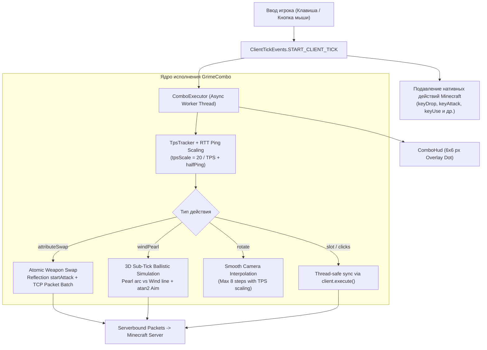

# GrimeCombo ⚡

[](https://fabricmc.net/)
[](https://openjdk.org/)
[](#-архитектура-и-киллер-фичи)
[](LICENSE)
[](https://github.com/GrimeVoid/GrimeCombo)

> **Язык / Language:** **Русский** | [English](README.md)

Высокотехнологичный клиентский комбо-движок тактических макросов и баллистической физики для **Minecraft Fabric (1.21.x / 26.2, Java 25)**, привносящий механику способностей в стиле **MOBA-игр** в соревновательный Minecraft.

---

## 📑 Содержание

- [🎯 Назначение и решаемая проблема](#-назначение-и-решаемая-проблема)
- [⚡ Архитектура и киллер-фичи](#-архитектура-и-киллер-фичи)
  - [1. Атомарный Attribute Swap (Spear Dash / Weapon Swap)](#1-атомарный-attribute-swap-spear-dash--weapon-swap)
  - [2. Wind Pearl: 3D Субтиковая Баллистика Перехвата](#2-wind-pearl-3d-субтиковая-баллистика-перехвата)
  - [3. Dynamic TPS & RTT Ping Scaling (TpsTracker)](#3-dynamic-tps--rtt-ping-scaling-tpstracker)
  - [4. Обход ванильного перехвата клавиш (START_CLIENT_TICK Suppression)](#4-обход-ванильного-перехвата-клавиш-start_client_tick-suppression)
  - [5. Декларативный TOML-конфиг и горячая перезагрузка](#5-декларативный-toml-конфиг-и-горячая-перезагрузка)
  - [6. Минималистичный HUD Индикатор](#6-минималистичный-hud-индикатор)
- [🛠️ Справочник действий (Action Reference)](#️-справочник-действий-action-reference)
- [⚙️ Примеры конфигураций (`grimecombo.toml`)](#️-примеры-конфигураций-grimecombotoml)
- [🛡️ Поведение на серверах и Античит-анализ](#️-поведение-на-серверах-и-античит-анализ)
- [📦 Сборка и установка](#-сборка-и-установка)
- [📄 Лицензия](#-лицензия)

---

## 🎯 Назначение и решаемая проблема

Современный соревновательный Minecraft (начиная с обновлений 1.21+ с ветряными зарядами *Wind Charge*, булавой *Mace*, копьем *Spear/Lance* и механикой *Crystal PvP*) перешел в плоскость гипердинамичных тактических дуэлей. Исход схватки решается за доли секунды:
- Игроку необходимо за **50–100 миллисекунд** сменить предмет в хотбаре, прицелиться под строгим углом, применить способность, сбросить кулдаун, переключить оружие и вернуть исходный слот.
- **Человеческий фактор:** среднее время реакции человека составляет 200–250 мс, а физический дребезг пальцев и миссклики приводят к фатальным ошибкам (сорванный трикшот пёрла, потеря оружия или мисс по кристаллу).
- **Сетевой лаг и нестабильный TPS:** на перегруженных серверах тикрейт падает с 20 до 10–14 TPS, из-за чего фиксированные макросы "проглатываются" сервером, а пакеты приходят не вовремя.
- **Ограничения ванильного движка:** стандартный метод `Minecraft.handleKeybinds()` перехватывает клики последовательно в главном потоке рендера, приводя к задержкам и конфликтам клавиш.

**GrimeCombo решает эти проблемы на фундаментальном инженерном уровне:**
1. Превращает сложные многофазные механики в **детерминированные тактические способности** на одну кнопку (клавиатура или мышь).
2. Выполняет расчеты в отдельном асинхронном пуле потоков (`CompletableFuture`), не просаживая FPS и не вызывая микрофризов клиента.
3. Рассчитывает 3D-траектории полета снарядов в реальном времени с учетом скорости движения игрока, гравитации, сопротивления воздуха и сетевого пинга.
4. Выполняет атомарный обмен атрибутами оружия в пределах нулевой задержки TCP-батчинга.

---

## ⚡ Архитектура и киллер-фичи



### 1. Атомарный Attribute Swap (Spear Dash / Weapon Swap)

Механика **Attribute Swap** позволяет активировать способность или импульс движения одного предмета (например, рывок копьем *Spear Dash* или использование трезубца), мгновенно наделяя атаку атрибутами целевого оружия (топор с максимальным базовым уроном или меч с чарами отдачи):

* **0 мс TCP Packet Batching:**
  В одном кадре синхронизации с клиентом (`client.execute()`) мод выполняет смену слота на оружие использования (`ServerboundSetCarriedItemPacket(useSlot)`), затем инициирует атаку и **тут же** переключает слот на целевое оружие (`ServerboundSetCarriedItemPacket(targetSlot)`). Пакеты объединяются операционной системой в единый TCP-фрейм, регистрируя атаку на сервере без единого кадра задержки рендера.
* **Вызов через Java Reflection (`startAttack`):**
  Вместо искусственного эмулирования зажатия клавиши атаки (которое требует ожидания следующего тика рендера), GrimeCombo напрямую задействует приватный метод `Minecraft.startAttack()` через Java Reflection с безопасным fallback'ом на `gameMode.attack()` и `ServerboundSwingPacket`.
* **Результат:** 100% сохранение импульса рывка с уроном топора в момент контакта с противником.

---

### 2. Wind Pearl: 3D Субтиковая Баллистика Перехвата

Трюк **Wind Pearl** — один из самых зрелищных и технически сложных приемов в современном PvP: игрок бросает жемчужину Края (*Ender Pearl*), а затем подрывает её в воздухе ветряным зарядом (*Wind Charge*), придавая пёрлу огромное ускорение для мгновенной телепортации на 40–80+ блоков.

Вручную этот трюк нестабилен: траектория пёрла параболическая (с гравитацией и сопротивлением воздуха), траектория ветряного заряда прямолинейная ($1.5$ бл/тик), а игрок находится в движении.

GrimeCombo производит **математическую симуляцию баллистики в реальном времени**:

1. **Учет начального импульса движения:**
   $$\vec{v}_{pearl} = \vec{v}_{look} \cdot 1.5 + \vec{v}_{player}$$
   Мод считывает текущий вектор движения игрока (`player.getDeltaMovement()`) и статус нахождения на земле (`onGround`).
2. **Динамика полета жемчужины на 60 тиков вперед:**
   $$v_y(t+1) = (v_y(t) - 0.03) \times 0.99$$
   $$v_x(t+1) = v_x(t) \times 0.99, \quad v_z(t+1) = v_z(t) \times 0.99$$
3. **Субтиковая линейная интерполяция точки перехвата:**
   Когда расстояние, пройденное ветряным зарядом $d_{wind} = 1.5 \cdot (t - t_{delay})$, догоняет дистанцию до пёрла $d_{pearl}$, мод производит субтиковую интерполяцию между тиками $t-1$ и $t$:
   $$\text{frac} = \frac{\Delta_{prev}}{\Delta_{prev} + \Delta_{curr}}$$
   $$\vec{P}_{hit} = \vec{P}_{prev} + \text{frac} \cdot (\vec{P}_{curr} - \vec{P}_{prev})$$
4. **Мгновенный расчет углов прицеливания:**
   $$\text{Pitch} = -\operatorname{atan2}(P_{hit.y} - 1.62, \sqrt{P_{hit.x}^2 + P_{hit.z}^2})$$
   $$\text{Yaw} = \operatorname{atan2}(-P_{hit.x}, P_{hit.z})$$
5. **Аппаратная фиксация инпута:**
   На время расчета и выстрела активируются флаги `isMouseLocked` и `isInputLocked`, блокирующие случайное смещение мыши и клавиш WASD до момента успешного детонирования.

---

### 3. Dynamic TPS & RTT Ping Scaling (TpsTracker)

Обычные макросы используют фиксированные задержки (`Thread.sleep(50)`), что приводит к гарантированному сбою на лагающих серверах. GrimeCombo оснащен интеллектуальным адаптером задержек:

* **TpsTracker:**
  Анализирует скользящее окно из последних 40 тиков клиента/сервера с наносекундной точностью (`System.nanoTime()`), а также опрашивает ванильный `tickRateManager().tickrate()` (введенный в Fabric 1.21+).
* **Масштабирование времени (TPS Scale):**
  $$tpsScale = \frac{20.0}{\text{TPS}}$$
  * При $\text{TPS} = 20.0 \implies tpsScale = 1.0$ (штатные задержки).
  * При $\text{TPS} = 10.0 \implies tpsScale = 2.0$ (все паузы автоматически удваиваются, чтобы сервер успел обработать пакеты).
* **Сетевая компенсация пинга (RTT Latency):**
  $$\text{ScaledDelay} = \max\left(1, \operatorname{round}(baseDelay \cdot tpsScale)\right) + \frac{\text{Ping}_{\text{RTT}}}{2}$$
  Каждое действие учитывает половину сетевого пути до сервера, гарантируя стабильную доставку последовательности.

---

### 4. Обход ванильного перехвата клавиш (START_CLIENT_TICK Suppression)

В обычном клиенте Minecraft при нажатии клавиши, привязанной к хотбару или атаке, игра немедленно вызывает обработчик `handleKeybinds()`, вызывая конфликт между комбо и ванильным действием.

GrimeCombo внедряется на фазе **`ClientTickEvents.START_CLIENT_TICK`** — строго **до** того, как ванильный движок успеет опросить клавиатуру:
1. Мод обнаруживает нажатие бинда комбо.
2. Мгновенно подавляет стандартные привязки (`keyDrop`, `keyUse`, `keyAttack`, `keyPickItem`, слоты хотбара), сбрасывая состояние:
   ```java
   KeyMapping.set(km.getDefaultKey(), false);
   while (km.consumeClick()) {}
   ```
3. **Сохранение мобильности:** клавиши передвижения (**WASD**, **Пробел**, **Shift**), открытие инвентаря (**E**) и смена рук (**F**) **строго исключены из подавления**, сохраняя полный контроль над персонажем в гуще боя.
4. **Поддержка мыши:** бесшовный биндинг на левую (`LMB`), правую (`RMB`), среднюю (`MMB`) и дополнительные боковые кнопки мыши (`MOUSE4`, `MOUSE5`, `SIDE_BACK`, `SIDE_FORWARD`).

---

### 5. Декларативный TOML-конфиг и горячая перезагрузка

* **Нулевые зависимости:** встроен собственный сверхбыстрый парсер TOML (`TomlSimpleParser`), не требующий подключения внешних тяжелых библиотек.
* **Горячая перезагрузка на лету:** при нажатии клавиши переключения мода (по умолчанию **`G`**) файл `config/grimecombo.toml` асинхронно перечитывается в фоновом потоке. Можно править конфиг прямо во время игры без перезапуска клиента!
* **Действие `restore_slot`:** мод запоминает исходный слот, в котором находился игрок в момент нажатия комбо, и автоматически возвращает его в руку по завершении последовательности.

---

### 6. Минималистичный HUD Индикатор

* Отображается в правом верхнем углу экрана через нативный `HudElementRegistry.addLast()`.
* Точка размером 6x6 пикселей с черной контрастной окантовкой:
  * 🟢 **Зеленый (`#00FF44`)** — Движок комбо активен.
  * 🔴 **Красный (`#FF2233`)** — Движок выключен.
* **Smart Fail-Safe:** режим комбо автоматически выключается при смерти игрока или открытии окна чата, предотвращая случайный запуск макросов во время общения.

---

## 🛠️ Справочник действий (Action Reference)

Каждое комбо в блоке `[[combo]]` конфига содержит массив строк `actions`:

| Команда | Синтаксис | Описание |
| :--- | :--- | :--- |
| **`slot`** | `slot <1-9>` | Переключение на слот хотбара (1-based, от 1 до 9) |
| **`rotate`** | `rotate <yaw> <pitch>` | Плавный поворот камеры на относительные углы (градусы) |
| **`left_click`** | `left_click` | Одиночный левый клик (атака / удар / снос) |
| **`right_click`** | `right_click` | Одиночный правый клик (использование предмета / блока) |
| **`delay`** | `delay <ms>` | Пауза перед следующим шагом (авто-скейлится с учетом TPS и пинга) |
| **`jump`** | `jump` / `space` | Одиночный прыжок с земли |
| **`restore_slot`** | `restore_slot` | Возврат на исходный слот, который был в руках до старта комбо |
| **`windPearl`** | `windPearl <dist> <pearlSlot> <windSlot>` | 3D-баллистический трикшот подрыва пёрла ветряным зарядом |
| **`attributeSwap`** | `attributeSwap <useSlot> <targetSlot> [R/L] [holdMs]` | Атомарный свап атрибутов оружия (Spear Dash / Lance Charge) |

---

## ⚙️ Примеры конфигураций (`grimecombo.toml`)

Файл конфигурации автоматически генерируется по пути `.minecraft/config/grimecombo.toml`:

```toml
# Глобальная клавиша включения/выключения мода (G по умолчанию)
toggle_key = "G"

# ========================================================
# 1. 3D-Баллистический Wind Pearl (Бросок пёрла + подрыв ветром)
# ========================================================
[[combo "Wind Pearl Boost"]]
bind = "R"
cooldown_ms = 1200
actions = [
    "windPearl 35 4 5",    # Пёрл в слоте 4, Ветряной заряд в слоте 5
    "delay 20",
    "restore_slot"         # Возврат исходного оружия
]

# ========================================================
# 2. Spear Dash (Копейный рывок с моментальным уроном топора)
# ========================================================
[[combo "Spear Dash"]]
bind = "Q"
cooldown_ms = 700
actions = [
    "attributeSwap 6 1 L 50", # Слот 6 (копье) -> Слот 1 (топор), ЛКМ, 50мс удержание
    "restore_slot"
]

# ========================================================
# 3. Crystal PvP Fast-Place (Обсидиан + Кристалл + Удар мечом)
# ========================================================
[[combo "Crystal Bomb"]]
bind = "C"
cooldown_ms = 500
actions = [
    "slot 8",        # Обсидиан
    "right_click",
    "slot 7",        # Кристалл Энда
    "rotate 0 -5",
    "right_click",
    "slot 1",        # Меч / Топор
    "left_click",
    "restore_slot"
]

# ========================================================
# 4. Emergency Escape (Мгновенный разворот на 180° и бросок пёрла)
# ========================================================
[[combo "Emergency Pearl"]]
bind = "MOUSE4"      # Боковая кнопка мыши (Назад)
cooldown_ms = 800
actions = [
    "rotate 180 -30",
    "slot 4",
    "right_click",
    "rotate 180 30",
    "restore_slot"
]
```

---

## 🛡️ Поведение на серверах и Античит-анализ

Мод является **полностью клиентским (client-side)** и не требует установки серверной части. При использовании на соревновательных серверах с античитами (GrimAC, Vulcan, Polar, Matrix) учитывайте следующие технические факторы:

1. **Человеческий фактор (Humanized Delays):**
   В движок встроен случайный разброс времени между действиями ($22–60\text{ мс}$), предотвращающий детекты по паттернам идентичных интервалов кликов.
2. **Вращение камеры (`rotate`):**
   Поворот камеры выполняется многошаговой интерполяцией по кривой Безье с ограничением вертикального угла $[-80^\circ, +80^\circ]$. Для строгих эвристик GrimAC GCD рекомендуется использовать небольшие углы поворота.
3. **Пакетный обмен (`attributeSwap`):**
   Пакет `ServerboundSetCarriedItemPacket` отправляется легитимно через сетевой менеджер Minecraft. На серверах с агрессивным FastSwitch плагином используйте `holdMs` не менее $50\text{ мс}$.

---

## 📦 Сборка и установка

### Системные требования:
* **Minecraft:** 1.21.x / 26.2 (Fabric)
* **Fabric Loader:** `>= 0.19.3`
* **Java Development Kit (JDK):** **25** (OpenJDK / Eclipse Temurin 25)

### Сборка из исходников:

```bash
# Клонирование репозитория
git clone https://github.com/GrimeVoid/GrimeCombo.git
cd GrimeCombo

# Сборка мода через Fabric Loom (Gradle)
./gradlew build
```

Собранный файл мода появится в директории:
```
build/libs/grimecombo-1.0.0.jar
```

### Установка:
1. Установите [Fabric Loader](https://fabricmc.net/) и [Fabric API](https://modrinth.com/mod/fabric-api) для вашей версии Minecraft.
2. Поместите собранный `grimecombo-1.0.0.jar` в папку `.minecraft/mods/`.
3. Запустите игру. Конфигурационный файл будет автоматически создан в `.minecraft/config/grimecombo.toml`.

---

## 📄 Лицензия

Проект распространяется под открытой лицензией [MIT License](LICENSE). Разрешено свободное использование, модификация и распространение.
